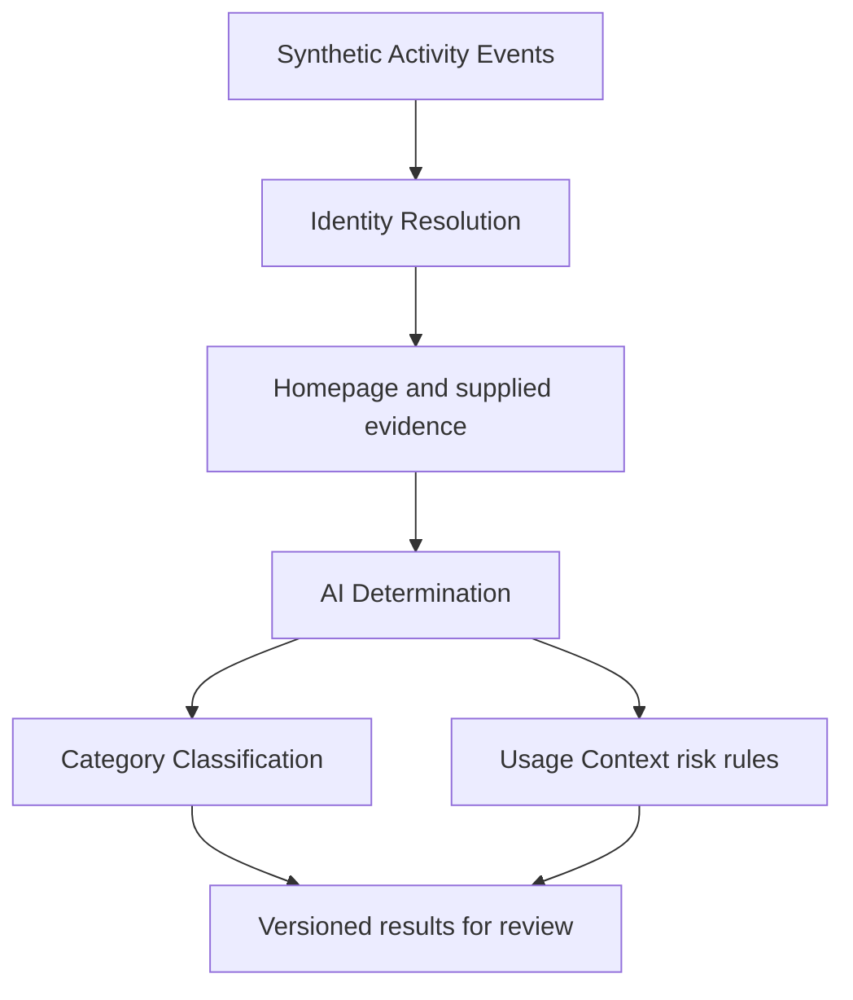
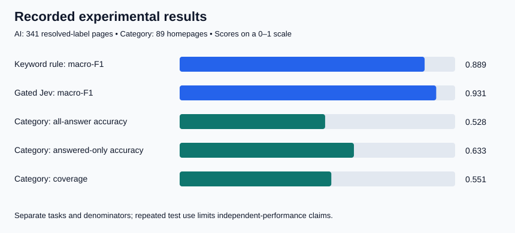

# Cyera: AI Tool Discovery & Risk Classification

A Break Through Tech AI Studio team project with Cyera: a prototype for discovering AI functionality in software and helping analysts investigate contextual governance risk.

**Status:** research experiments, synthetic activity fixtures, and a FastAPI backend are implemented. The analyst-facing frontend and complete assistant integration are ongoing work. This is an educational prototype, not a production security or compliance determination.

## Overview and objectives

Unmanaged AI use can be difficult to identify from ordinary application activity. This project separates five questions: what Tool was observed, whether its own functionality performs AI work, which business Category applies, how it is used, and what governance-risk rules apply to that Usage Context.

Our objectives are to discover previously unseen Tools, distinguish substantive AI functionality from marketing mentions, classify AI Tools into 14 business-function Categories, and expose risk reasons and unresolved evidence for analyst review. A browser visit is not proof that sensitive information was submitted.

## Start here

- [Local setup, API walkthrough, and evaluation guide](docs/project-guide.md)
- [Offline results walkthrough notebook](notebooks/project_walkthrough.ipynb): inspect the included sample and saved results without API credentials.
- [Synthetic Activity Events and data contract](data/synthetic_enterprise_activity/v1/README.md)
- [AI Determination experiments](notebooks/ai_cascade/README.md)
- [Category baseline experiment](notebooks/category_classification/README.md)
- [Domain vocabulary](CONTEXT.md) and [assistant integration status](docs/assistant-integration.md)

## Methodology

1. **Identity Resolution:** group observed identity clues and match them against a versioned registry, respecting held-out Tool exclusions.
2. **AI Determination:** a keyword/capability gate and TypeSafe Jev judge produce AI, non-AI, or unresolved outcomes. An AI mention alone is insufficient. Separate sentence scoring provides an evidence trail and review flag. See [ADR 0001](docs/adr/0001-ai-tool-requires-own-ai-functionality.md) and [ADR 0002](docs/adr/0002-binary-ai-detection-uses-gated-jev-judge.md).
3. **Category Classification:** compare evidence embeddings with 8,214 training descriptions using a similarity-weighted vote among 15 neighbors. Low-score answers abstain. [ADR 0003](docs/adr/0003-category-classification-uses-semantic-neighbor-vote.md) documents the implemented approach and remains marked proposed.
4. **Contextual Risk Assessment:** deterministic, versioned rules use supplied scenario facts. Policy Status and Data Sensitivity Tier are not inferred from activity; unknown facts remain explicit.
5. **Analyst support:** persist Batches, Analysis Runs, and assessments. Assistant workflow and provider integration exist, but query/RAG connections and the assistant HTTP interface are not complete.

## Data and exploration

| Dataset | Role and boundary |
| --- | --- |
| Cleaned AIToolBuzz catalog | 13,701 rows; Category labels are examples, not proof of AI functionality. |
| Category partitions | 8,214 train / 2,739 validation / 2,738 test descriptions; conservative grouping limits identity and text leakage. Ten conflicting duplicate-description rows are withheld. |
| Website evidence | Frozen development and evaluation captures test transfer beyond catalog descriptions. Labels include unresolved cases. |
| Synthetic enterprise activity | 265 Activity Events, 44 active fictional employees, nine departments, and ten observed applications; scenario coverage is not a prevalence estimate. |

The [synthetic sample](data/synthetic_enterprise_activity/v1/activity.csv) is included for testing. Its companion metadata contains fictional policy/vendor assumptions, not factual assertions about named vendors. Files under `evaluation_only/` are scoring fixtures and must not become inference or retrieval inputs.

## Recorded results and key findings

These are the team's **saved experimental results**, not a new live evaluation or an individual's performance claim.

| Experiment | Recorded result | Interpretation |
| --- | --- | --- |
| AI Determination: keyword rule | Macro-F1 0.889 on 341 resolved-label pages | Baseline on the 409-page test2 sample. |
| AI Determination: gated Jev | Macro-F1 0.931; accuracy 0.918 on the same 341 pages | Seven false alarms, 14 missed AI cases, and 15 abstentions on resolved-label pages. |
| Category neighbor vote, all answers | Accuracy 0.566 on 2,738 descriptions; 0.528 on 89 homepages | Transfer to homepage evidence is harder than catalog classification. |
| Category neighbor vote, frozen cutoff | Accuracy 0.633 on 49 answered homepages; coverage 55.1% | Abstention improves answer precision but leaves many Tools unresolved; the validation target of 70% was not reached on test homepages. |

Sources: [AI results JSON](notebooks/ai_cascade/test2_jev_results.json), [Category results JSON](notebooks/category_classification/test_results.json), and [frozen Category configuration](notebooks/category_classification/FREEZE.json). The walkthrough notebook reads these files directly.

**Limits:** test2 was reused to compare Jev; Category test data had also been evaluated previously. AI reference labels came from two passes of the same model family, not independent human ground truth. Further tuning needs fresh independent evaluation. No complete end-to-end analyst-quality or production-readiness result is claimed.

## Team and individual contributions

| Member | Role / confirmed contribution |
| --- | --- |
| Shubham Arya — [Arya25](https://github.com/Arya25) | Challenge Advisor |
| Aram Ramos — [aramseries](https://github.com/aramseries) | AI Coach |
| Newton Ma — [newtonma7](https://github.com/newtonma7) | Fellow; implementation and research changes are recorded in repository history. |
| Elaine Zou — [elainez-3214](https://github.com/elainez-3214) | Fellow; detailed contribution summary pending team confirmation. |
| Katy Ng — [katy-ng](https://github.com/katy-ng) | Fellow; detailed contribution summary pending team confirmation. |
| Swarna Sre Ganesh Shankar — [chanabyte](https://github.com/chanabyte) | Fellow; detailed contribution summary pending team confirmation. |
| Seedorf Otchere — [seeedorfff](https://github.com/seeedorfff) | Fellow focused on design and frontend; interface work is in progress. |
| Dipsha Budhathoki — [rhaeg4r](https://github.com/rhaeg4r) | Fellow; detailed contribution summary pending team confirmation. |

Team results above belong to the collaborative project. See [commit history](https://github.com/Break-Through-Tech/Cyera-1A-ai-tool-discovery-and-risk-classification/commits/main) for changes; off-repository research and design work should be confirmed by its contributors before adding completion claims.

## Next steps

- Connect the analyst frontend to the implemented Batch and Analysis Run APIs.
- Finish query/RAG integration and expose the assistant inspection interface.
- Validate complete analyst journeys and live-provider behavior.
- Review uncertain labels and gather fresh independent test examples before further tuning.
- Investigate Category transfer errors and calibrate coverage versus answer quality.
- Complete each team member's contribution summary and confirm data redistribution and licensing with the advisor.

## Acknowledgments and license

Developed through Break Through Tech AI Studio with Cyera, supported by the Challenge Advisor and AI Coach. Existing experiment documents record model-assisted labeling and judging where used. This documentation update was prepared with AI assistance from repository evidence and requires team review. No project license is asserted here; the team should obtain advisor approval before adding one.
