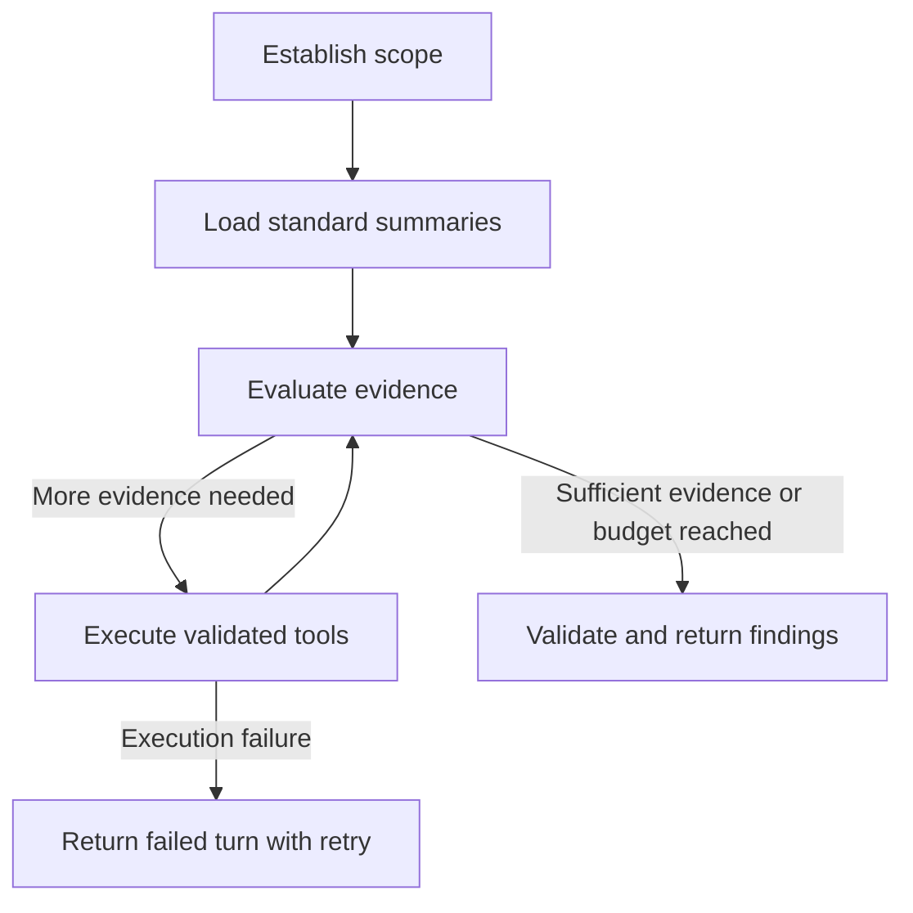

# Governance agent uses bounded tools and LangGraph

## Context

The Governance Analyst needs to understand which AI-tool usage deserves attention, why it matters, and what evidence to investigate next. The first deliverable is a briefing for a completed Batch analysis. Analyst-directed conversations can later reuse the same tools to investigate dates, departments, Categories, and particular findings.

Semantic retrieval alone cannot answer questions about counts, organizational spread, or changes over time. Those questions require deterministic queries over Activity Events and stored Analysis Run results. An LLM adds value by selecting investigations, connecting supported facts, explaining uncertainty, and suggesting next steps.

The [project plan](../../PROJECT_PLAN.md#rag-governance-assistant-contract--confirmed-implementation-details-deferred) already requires deterministic queries, grounded explanations, and read-only assessments. This ADR specifies the agent orchestration and initial delivery scope. It does not change AI Determination, Category Classification, or contextual-risk rules.

## Decision

Use one tool-calling LLM inside a small LangGraph workflow in the existing FastAPI backend. Python functions expose validated, bounded operations over the database and retained evidence. The model chooses tool arguments and follow-up investigations. Backend code owns queries, calculations, permissions, and citation resolution.

The agent produces interpretations and advisory investigation priorities. It cannot create or override stored identities, classifications, Policy Status, or risk tiers. An advisory priority is distinct from a contextual-risk tier and must be labeled accordingly.

LangGraph coordinates deterministic briefing steps and a flexible investigation loop. Use explicit state and conditional transitions rather than separate planner, researcher, and reviewer agents.

## Initial workflow

The briefing starts on request for a selected Batch with a successful Analysis Run. Automatic invocation after analysis can be added later without changing the investigation tools.

1. Resolve and pin the Batch and successful Analysis Run. Establish the available event-time range and disclose the selected scope.
2. Run standard summaries covering usage, departmental distribution, flagged Usage Contexts, and missing assessment facts.
3. Give the agent compact results and evidence references. Let it request targeted follow-up operations when they can clarify a finding.
4. Stop when the evidence is sufficient or the configured execution budget is reached.
5. Validate the response structure and citation references, then return the briefing with its scope and limitations.

An execution-budget stop must disclose any material unfinished investigation. A database, retrieval, or model-service failure produces a failed turn with retry, rather than a substantive answer assembled from partial results.

The investigation loop is:

Analyst conversations later enter the same loop after resolving the question's scope. They can skip the standard briefing summaries when a narrower query answers the request.

## Tool contracts

The initial tool names are proposed interfaces, not existing backend functions. Keep their implementations independent of LangGraph so they can be tested and called directly.

| Tool | Responsibility |
|---|---|
| `describe_dataset` | Return available dates, departments, Categories, analysis coverage, and material missing fields. |
| `summarize_usage` | Filter Activity Events and stored results, then return counts or grouped summaries. |
| `compare_usage` | Compare explicitly scoped periods using the same filters and count definitions. |
| `get_risk_assessments` | Return stored contextual-risk tiers, reason codes, investigation flags, and unknown facts. |
| `get_evidence` | Return bounded supporting records and the lineage behind a particular result. |
| `retrieve_context` | Retrieve relevant retained project-policy, governance, or Tool evidence once the controlled corpus is available. |

FastAPI validates typed tool arguments before SQLAlchemy constructs queries. The agent receives no arbitrary SQL or Python execution tool. Tools support compatible filters for event time, department, Category, AI status, and stored assessment fields. Unsupported combinations produce an explicit limitation or clarification.

Tool contracts must preserve these properties:

- Time intervals use an inclusive start and exclusive end, with an explicit timezone. Resolve calendar dates to the stored UTC event timestamps.
- Return applied scope, metric definitions, contributing Run references, and stable evidence references alongside results.
- Distinguish event counts, distinct employees, Tools, and Usage Contexts. Keep unresolved AI status, Category, and risk outcomes visible where relevant.
- Bound record and group counts. Disclose truncation and provide pagination or drill-down rather than treating a limited response as the full population.
- Distinguish no matching records, unavailable data, unsupported requests, and execution failures.
- Return summaries first. Fetch detailed evidence only when needed, without dropping material unknowns or conflicts.

The backend enforces the allowed data scope. Model-generated arguments cannot expand access or change the selected historical result.

## State and conversation behavior

Keep explicit state for the request, selected Batches and Runs, active filters, compact tool results, evidence references, candidate findings, and remaining execution budget. Record tool calls and outcomes for debugging and evaluation.

Follow-ups such as "show Engineering instead" update the relevant filter while retaining the established scope. Clarify terms when different interpretations materially change the population or meaning. Conversation history resolves references but is never evidence.

General conversational questions retain the project plan's database-wide contract. Select the latest successful Run for each Batch at the start of a new general question. Failed Runs do not replace successful results. Follow-ups about an earlier finding retain its producing Runs and disclose newer results rather than silently substituting them.

Cross-Batch aggregation uses confirmed known-Tool identities. Unknown observed Tools remain Batch-scoped. Count supplied events without automatic deduplication, disclose exact-overlap or conflicting-ID warnings, and retain Batch-qualified event references. Disclose material model or rule version differences across contributing Runs.

LangGraph persistence is available for future execution recovery, but this ADR does not require saved conversations. The initial chat lifetime remains the current open session. Reloading starts a new conversation, as specified in the project plan.

## Findings and evidence

Produce structured findings before rendering the briefing. Each finding includes:

- A concise statement of what deserves attention.
- Observed facts and metrics with claim-linked evidence references.
- An interpretation that explains why the facts matter together.
- Material unknowns and limits on the conclusion.
- A clearly labeled advisory next step when supported.

The response also identifies its event-time scope, filters, count definitions, and contributing Analysis Runs. Aggregate evidence exposes the query definition and a way to inspect included records. A short conversational answer need not use the full briefing format.

For example, adoption across Finance and Engineering can justify an approval review. It does not establish that employees submitted sensitive data. Missing vendor terms remain unknown, and an unresolved determination remains unresolved.

Use recorded result lineage to explain a determination or assessment. Semantic retrieval supplies relevant retained context, but cannot replace the evidence that produced the stored decision. Recommendations distinguish project demonstration rules, general governance guidance, and recorded organization-specific policy.

Validate output schemas and reference existence in code. Those checks do not prove that an interpretation follows from its evidence. Evaluate claim support separately.

## Boundaries and execution controls

Use configurable tool-call, time, and output-size limits. Retrieved passages, uploaded text, and conversation content cannot expand tool permissions. The assistant has no live-web browsing, approval, enforcement, or assessment-writing tools.

The initial briefing operates on stored pipeline outputs and their retained evidence. Document retrieval follows when a controlled local corpus and its evaluation cases exist. No vector database, embedding model, LLM provider, or autonomous remediation workflow is selected here.

## Considered options

- **LangGraph with one agent, chosen.** Explicit transitions support standard briefing coverage and adaptive follow-up queries in the same workflow. State carries filters and result provenance between steps. The cost is an additional dependency and responsibility for graph state and transitions.
- **OpenAI Agents SDK.** Function tools, sessions, and tracing fit a conversational tool loop. LangGraph is preferred for explicit control over the deterministic briefing steps and the investigation loop. This is a project-fit decision, not a claim that the SDK cannot implement the workflow.
- **Direct model SDK loop.** Provides full control with fewer framework concepts, but requires application code for execution transitions, state, and recovery behavior.
- **Vector retrieval followed by a summary.** Useful for document questions, but cannot establish complete event counts or temporal comparisons.
- **Generated SQL or Python.** Adds validation and execution complexity when the required operations can be expressed through typed tools. Flexible filters and tool composition provide the intended investigative freedom.

## Delivery and acceptance

Deliver one complete path first: a Batch briefing over stored analysis results, with drill-down to evidence. Then add analyst-directed filters and follow-ups using the same query functions. Add controlled document retrieval after the structured investigation path works.

Acceptance scenarios must establish the following behavior:

- Counts, grouped summaries, and period comparisons match independently specified fixture expectations and database queries.
- The standard briefing covers unapproved and flagged contexts, unresolved outcomes, and material missing evidence.
- A department-and-date question applies the intended filters. A follow-up changes only the requested scope, with clarification for material ambiguity.
- General questions and historical follow-ups obey Run selection, cross-Batch identity, overlap disclosure, and provenance rules.
- Every material factual claim has valid supporting references. Interpretations do not assert sensitive-data submission, policy violations, or changed tiers without evidence.
- No-match results, sparse or conflicting evidence, truncation, execution-budget stops, and service failures remain distinguishable.
- Untrusted text cannot invoke unsupported operations, override scope restrictions, or authorize writes.

Inspect tool traces alongside answers. Report deterministic correctness, citation correctness, claim support, and document-retrieval relevance separately. Exact evaluation datasets, model selection, and execution-budget values remain implementation decisions.

## Relationship to the project plan

The conversation initially proposed a selected-Batch starting point and discussed persistent investigations. The project plan instead makes database-wide chat the core conversational scope and requires only open-session history. This ADR adopts the selected-Batch briefing as the first deliverable while preserving those conversational contracts. Saved chats and automatic post-analysis briefings remain deferred.

## References

- [Project plan: assistant contracts](../../PROJECT_PLAN.md#rag-governance-assistant-contract--confirmed-implementation-details-deferred).
- [ADR 0002: AI Determination](0002-binary-ai-detection-uses-gated-jev-judge.md).
- [ADR 0003: Category Classification](0003-category-classification-uses-semantic-neighbor-vote.md).
- [Microsoft Security Analyst Agent](https://learn.microsoft.com/en-us/defender-xdr/security-analyst-agent). Inspiration for an evidence-backed investigation workflow. Microsoft documents KQL retrieval and Python analysis, but does not establish that its agent exclusively uses predefined functions.
- [LangGraph overview](https://docs.langchain.com/oss/python/langgraph/overview).
- [LangGraph workflows and agents](https://docs.langchain.com/oss/python/langgraph/workflows-agents).
- [OpenAI Agents SDK](https://openai.github.io/openai-agents-python/).
