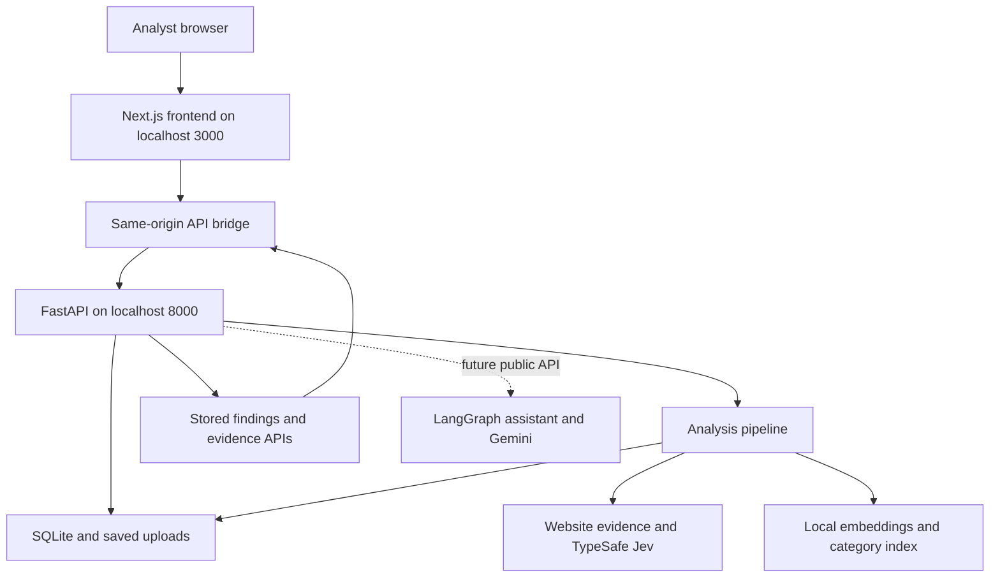

# Frontend product requirements

Status: draft for milestone review. Updated November 24, 2026.
Backend baseline: `d271c83`, currently included in the `frontend` branch.
Implementation plan: [Frontend roadmap](roadmap.md).

## 1. Purpose and product outcome

Build the analyst interface for the team's AI Tool Discovery and Risk Classification application. A governance analyst uploads enterprise activity, discovers which applications involve AI, investigates their usage, and understands the evidence behind contextual risk findings.

The frontend is the presentation and interaction layer of the existing application. FastAPI owns ingestion, analysis, queries, and persistence. Models and deterministic rules execute in the backend. The frontend makes their outputs understandable and traceable; it does not calculate replacement risk scores or run ML inference.

The primary demonstration journey is:

**Upload activity → inspect analysis outcome → review overview → find an application or flagged usage context → inspect reasons and evidence.**

An assistant will later explain stored findings with citations when its public API is ready.

## 2. Confirmed decisions and open decisions

Confirmed with the frontend owner:

- Run locally for personal development and team demos; deployment comes later.
- The owner has a full visual direction in pen.dev and HTML and will provide it. This is the intended visual reference. Existing Figma wireframes remain useful for workflow coverage, not a mandate to override the new design.
- Implement one complete milestone, review it together, then proceed to the next.
- Frontend ownership covers design implementation, interactions, API integration, and verification. Backend/ML changes require coordination with their owners.

Proposed technical choices appear below and can be revised before scaffolding. Open questions for the design handoff are branding, fonts/assets and their availability, intended viewport sizes, and whether the supplied HTML is a prototype or production foundation. Theme support will follow that handoff; do not assume dark mode is required.

Local prototype scope assumes a single analyst without login or role management. Confirm any team requirement for authentication before adding it. A public deployment requires a separate hosting, access-control, persistence, and long-request decision.

## 3. Users and requirements

The primary user is a governance/security analyst. The secondary users are teammates reviewing the prototype and the frontend owner learning and documenting design-to-code decisions.

| ID | Requirement | Observable acceptance criterion |
|---|---|---|
| FE-01 | Upload and reopen datasets | A valid CSV creates a Batch, duplicate bytes reopen the existing Batch, and rejected input displays actionable errors. |
| FE-02 | Understand analysis | Batch details show the latest attempt, latest successful result, run history, failure information, and an explicit reanalysis action. |
| FE-03 | Understand scope | Every findings view identifies its selected data and Runs, applied filters, time window, and coverage warnings. |
| FE-04 | Review overview | Cards and charts use backend totals and definitions, and link to appropriately scoped investigation lists. |
| FE-05 | Explore applications | Search, filter, paginate, open details, and return without losing list context. Include unresolved candidates. |
| FE-06 | Investigate contextual risk | Show usage purpose, department, sensitivity, tier, reasons, unknowns, flag, rule version, and underlying events. |
| FE-07 | Inspect evidence | Open the stored source with its role, version, applicability, and any truncation or availability limitation. |
| FE-08 | Ask grounded questions later | Once supported, display scoped answers, citations, limitations, retry states, and advisory next steps. |
| FE-09 | Handle failures accessibly | Keyboard users can complete the core journey; loading, validation, empty, unavailable, and failed states are distinct. |

Core release success means a teammate can complete FE-01 through FE-07 on the synthetic fixture, identify why a context was flagged, and open its supporting evidence. Record usability feedback and observed completion problems rather than claim unmeasured productivity gains.

## 4. Proposed stack

Next.js and TypeScript were already planned in the project. The following is the proposed implementation stack; choose compatible stable releases and commit a lockfile during setup rather than prescribing unverified version numbers here.

| Layer | Choice | Purpose |
|---|---|---|
| Framework | Next.js App Router, React, TypeScript in strict mode | Routes, shared layout, interactive screens, and a thin server-side API bridge. |
| Styling | Tailwind CSS and CSS variables | Translate the supplied design into reusable spacing, color, typography, and surface tokens. |
| Accessible components | shadcn/ui where compatible with the supplied design | Starting primitives for dialogs, inputs, menus, and tables; customize appearance to the design. |
| Remote state | TanStack Query and native fetch | Queries, caching, mutations, cancellation, and targeted refresh after writes. |
| API types | Types generated from FastAPI OpenAPI | Keep request/response unions and nullability aligned with the backend; runtime errors still need handling. |
| Charts | Recharts, introduced with overview work | Simple distributions and trends with textual alternatives; verify suitability at that milestone. |
| Tests | Vitest, React Testing Library, Playwright | Contract/interaction tests and complete browser journeys. |
| Tooling | npm with package-lock, ESLint, TypeScript checks | Reproducible installation and focused quality checks. |
| Design sources | Owner's pen.dev design and HTML | Visual implementation reference; preserve design reasoning and reviewed deviations. |

Use URL search parameters for shareable selection/filter state, TanStack Query for server state, and component state for transient UI state. A separate global state library is not initially necessary.

Framework references: [Next.js App Router](https://nextjs.org/docs/app), [Next.js backend-for-frontend guide](https://nextjs.org/docs/app/guides/backend-for-frontend), [TanStack Query](https://tanstack.com/query/latest/docs/framework/react/overview), [shadcn/ui Next.js setup](https://ui.shadcn.com/docs/installation/next).

## 5. Overall architecture and boundaries



The proposed browser prefix is `/api/backend`; it is a frontend bridge, not an existing FastAPI prefix. Server-only `BACKEND_URL=http://127.0.0.1:8000` selects the backend. For example, browser `GET /api/backend/overview` forwards to FastAPI `GET /overview`.

The bridge must allow only supported methods and paths, preserve query parameters, response status and error bodies, forward multipart uploads correctly, and avoid caching mutable findings. It does not implement analysis, database access, model calls, or new domain rules. Limit forwarding to the configured backend rather than accepting arbitrary target URLs.

This same-origin approach avoids needing browser CORS support; the current FastAPI app does not configure CORS. If direct browser-to-FastAPI requests are chosen later, the backend must explicitly allow the frontend origin.

Backend runtime is Python 3.12+, FastAPI/Uvicorn, SQLAlchemy Core, SQLite, and Alembic. `backend/var` is the default local state directory. Migrations run during application creation. The existing `backend/README.md` is the setup authority.

Analysis uses backend-only `TYPESAFE_API_KEY`. Assistant configuration uses `GEMINI_API_KEY` and `GEMINI_MODEL`. These must never enter frontend bundles, browser storage, or client-visible environment variables. A healthy API does not guarantee configured live model services.

## 6. Backend and ML workflow the frontend represents

| Step | Implemented backend behavior | Frontend responsibility |
|---|---|---|
| Ingestion | Validate UTF-8 CSV, normalize header case/whitespace and surrounding value whitespace, reject invalid whole uploads, store immutable Batch and Activity Events. Duplicate content reuses a Batch. | File selection, schema help, pending state, line/field errors, duplicate notice, Batch link. |
| Identity resolution | Group activity clues into Tool Candidates; resolve known Tools, Batch-stable observed Tools, or unresolved candidates. | Keep identity status distinct from AI status and preserve unresolved candidates. |
| Website enrichment | Fetch/extract homepage evidence with destination checks and capture provenance. | Show source and capture information in detail/evidence views; no browser scraping. |
| AI determination | Deterministic keyword/capability gating plus TypeSafe Jev judging and evidence sentence scoring. Returns AI, non-AI, or unresolved, with review flags and provenance. Controlled supplied descriptions may be used according to configuration. | Show outcome, method, reason, supporting sentences, and review requirement. Probabilities are model output, not risk scores. |
| Category classification | AI-eligible results use catalog category where available; otherwise local BGE embeddings and weighted Semantic Neighbor voting. Insufficient evidence can remain unresolved; ineligible classification is inapplicable. | Explain category separately from usage purpose; expose method, neighbors, and uncertainty. |
| Context and risk | Group resolved AI usage into contexts using department, purpose, sensitivity, and observed window. Apply versioned deterministic synthetic governance rules. | Show context-specific assessments and reasons; never assign one universal risk score to an application. |
| Persistence | Save stage results and assessments for a successful Run, with versioned provenance; retain historical Runs. | Pin detail links to producing Run, distinguish latest attempt from latest successful results, and preserve history. |
| Read APIs | Provide scope-aware overview, applications, contexts, events, and evidence. | Render backend metrics with definitions and coverage; do not reconstruct totals from one paginated page. |
| Assistant foundations | Internal contracts, persistence, LangGraph workflow, Gemini adapter, and bounded query/evidence adapters exist. | Prepare later interaction design; public chat integration remains blocked on HTTP contracts. |

Important baseline distinctions:

- Current runtime risk rules are `synthetic-demo-risk-v1`: unapproved plus customer-data training permitted gives High; approved plus no training plus admin controls gives Lower; other partly known combinations give Medium; all unknown gives unresolved. Read returned rules and explanations rather than duplicating them in frontend code.
- The repository also contains risk-v2 design documents. Their existence does not mean v2 is the running evaluator.
- Category neighbor voting is implemented, although ADR 0003 retains a proposed status. Record that documentation mismatch without treating the running feature as absent.
- The assistant's document retrieval is not implemented. Public chat routes, orchestration entry points, and transport envelopes are not exposed by the current app. Controlled Python investigation is an architectural direction, not a frontend-ready capability.
- Activity is evidence of observed application use, not proof of confidential-data submission, AI-feature use, a policy violation, or compliance.

## 7. Screens and interaction requirements

### Data and analysis

Dataset directory with pagination, upload action, filename, upload date, event count, activity period, and latest attempt status. Batch details show immutable dataset information and run history. A failed latest attempt must not erase or silently replace an earlier successful result.

Upload help must list required columns: `event_id`, `timestamp`, `employee_id`, `department`, `application_name`, `domain`. Optional columns: `job_role`, `event_type`, `usage_purpose`, `data_sensitivity_tier`. Timestamps use UTC second precision, e.g. `2026-11-01T12:00:00Z`. Unknown columns and duplicate normalized headers are rejected. Use the existing synthetic fixture for demonstrations; do not invent a backend file-size limit.

**Lifecycle constraint:** `POST /batches` and reanalysis currently execute analysis synchronously before responding. Show “Uploading and analyzing” with indeterminate progress. No percentage, live stage timeline, WebSocket, or SSE capability is provided. A newly created Batch can return with a failed Run: HTTP success is not analysis success. Prevent double submission and do not automatically retry write requests after timeout. A lost connection does not prove the server stopped; reconcile through dataset/run reads before asking the analyst to reanalyze. Aborting the browser request does not cancel server analysis.

### Overview

Show backend headline metrics, AI determination distribution, flagged contexts, risk distribution, departments, categories, unresolved stages, and coverage-aware trends. Explicitly label event counts versus Tools versus Usage Contexts. Trend gaps with null counts remain unavailable coverage, not zero activity. Add charts incrementally once their data meaning and links are correct.

### Tools

Search application name/domain through the supported `application` parameter. Filter by AI determination, identity, and shared scope. Show backend-paginated results, including unresolved candidates. Details show identity, candidate-level AI and category evidence, activity, contexts, and policy status. If showing `highest_tier`, label it “Highest contextual tier” and link to contexts; it is not a global Tool assessment.

### Risk assessments and investigation

Use context listings and Run-pinned context detail. Display original assessed context separately from the narrower events matched by active filters. Show tier, flags, reasons, missing facts, metadata, rule version, and links to the Tool and Activity Events. Ineligible risk is distinct from an eligible but unresolved assessment.

### Evidence and activity

Provide a reusable evidence panel or detail view, with keyboard focus handling and a return path. Preserve source role: observed activity, model output, vendor claim, synthetic policy, analysis result/provenance, or governance guidance. Show supported text safely, source/version, applicability, truncation, and unavailable/error states. Event views are contextual drill-downs rather than a mandatory additional top-level destination.

### Assistant, gated milestone

Design a selected-Batch briefing first, then scoped follow-up questions. Show scope, grounded claims, interpretation, limitations, citations, and advisory next steps separately. Preserve earlier messages on failed turns. Until public contracts exist, show an honest unavailable state or omit the destination; do not ship simulated answers as live functionality.

Proposed routes: `/overview`, `/data`, `/data/[batchId]`, `/tools`, `/runs/[runId]/applications/[subjectKind]/[subjectId]`, `/risk`, `/runs/[runId]/contexts/[contextId]`, `/events`, and later `/assistant`. These are frontend URLs, distinct from backend routes.

## 8. Backend API integration map

All paths below are existing FastAPI paths at the inspected baseline unless marked otherwise. `S` means shared read scope; `P` means pagination. The live `/openapi.json` and `/docs` are the contract authority.

| Method and path | Inputs | Response and frontend use |
|---|---|---|
| `GET /health` | None | `{status: "ok"}`; API reachability. |
| `POST /batches` | Multipart `file` | `BatchOut`; 201 new upload, 200 duplicate; 422 invalid upload. New analysis is attempted before response. |
| `GET /batches` | P | Page of `BatchOut`; dataset directory. |
| `GET /batches/{batch_id}` | Batch ID | `BatchOut`; dataset details and latest-run references. |
| `POST /batches/{batch_id}/runs` | Batch ID; no JSON payload | `RunOut`; 201 completed attempt response; 409 if already running. Inspect returned status. |
| `GET /batches/{batch_id}/runs` | Batch ID, P | Page of `RunOut`; history. |
| `GET /runs/{run_id}` | Run ID | `RunOut`; running/succeeded/failed, timestamps, versions, failure phase/summary. |
| `GET /overview` | S | Scope, headline, activity, risk/policy distributions, departments, categories, trend, unresolved stages. |
| `GET /applications` | S, P, `ai_determinations`, `identity_outcomes`, `application` | Application page; each row includes batch/run and subject kind/ID for detail navigation. |
| `GET /runs/{run_id}/applications/{subject_kind}/{subject_id}` | Run ID, `tool` or `candidate`, matching ID | Application detail including candidates, evidence, activity, contexts, policy and risk. |
| `GET /contexts` | S, P, repeated `tool_ids` | Context page; risk investigation list. |
| `GET /runs/{run_id}/contexts/{context_id}` | Run ID and returned context number as path ID | Context detail, original scope, assessment, investigation flags, and events query. |
| `GET /events` | S, P; `ai_determinations`, `identity_outcomes`, `tool_ids`, `candidate_number`, `context_number` | Event page; follow backend-provided scope and context links. |
| `POST /evidence/resolve` | JSON `{reference: <typed EvidenceReference>}` | Read-only resolution of a single evidence reference. Use the generated discriminated union, not arbitrary strings. |
| `GET /runs/{run_id}/assessments` | Legacy Run ID, P, `tier`, `flagged` | Deprecated; do not use for new frontend screens. |
| Assistant HTTP API | Not available | Agree with backend owner; no invented `/chat` or streaming contract. |

Shared scope S: repeated `batch_ids`, `run_ids`, `departments`, `categories`, `policy_statuses`, `risk_tiers`; optional `flagged`, `start`, `end`. Dates are UTC, with inclusive start and exclusive end. Serialize arrays as repeated keys, e.g. `run_ids=abc&run_ids=def`, not comma-separated lists. Unspecified Runs use backend selection semantics; always display the actual returned selections.

Pagination P: `limit` (default 50, maximum 200) and `offset` (minimum 0). Response is `{items, total, limit, offset}`; scoped listings additionally return `scope` and endpoint-specific filters. Reset offset when filters change. Do not send unsupported sort/search parameters: unknown query parameters are rejected.

Read scope returns selections, filters, event time, count definitions, and coverage. Distinguish `no_batches`, `no_successful_runs`, and `available`, plus warnings for partial/conflicting coverage. Include the entire scope in query cache keys. Detail requests are Run-pinned; they do not accept arbitrary shared list filters.

Errors use `{code, message, details?}`. Upload details include `errors` with `line`, `field`, and `problem`; request errors use `location` and `problem`. Handle 404 missing records, 409 invalid Run state/conflict, 422 invalid input, unreachable backend, and malformed/non-JSON proxy errors. Show safe messages and a recovery action without exposing raw internal exceptions.

Evidence references include activity events, usage contexts, analysis Runs, AI evidence sentences, website captures, Tool metadata, category neighbors, and passages. Aggregate references are directed to listing operations rather than treated as a single source. Passage resolution remains dependent on retrieval availability.

## 9. Frontend structure

```text
frontend/
  PRD.md
  roadmap.md
  src/app/                 routes, layouts, API bridge
  src/components/ui/       shared accessible primitives
  src/components/layout/   navigation and scope controls
  src/features/            data, overview, tools, risk, evidence, assistant
  src/lib/api/             generated types, client, errors, query serialization
  src/lib/format/          timestamps, numbers, domain labels
  src/styles/              design tokens and global styles
  tests/                   meaningful integration and browser tests
```

Create folders as needed. Components do not call scattered hard-coded backend URLs. A shared client and feature query functions keep API contracts reviewable. Preserve raw domain values in transport; map them to readable labels only at presentation boundaries.

## 10. Quality and release criteria

- Keyboard-operable forms, navigation, filters, pagination, dialogs, and evidence links; visible focus and semantic headings/tables.
- Risk/state meaning conveyed with text and icons as well as color; charts have readable summaries.
- Responsive dashboard; verify the supplied design at desktop and a narrow viewport without losing essential actions.
- Loading, refreshing, empty, no matching results, no successful analysis, missing evidence, and connection failures each have appropriate copy/actions.
- Cancel obsolete reads and prevent stale responses from replacing results for a newer scope. Refresh relevant query keys after confirmed mutations.
- Test the integration against the deterministic synthetic workflow; live Jev/Gemini verification is separate and must not be implied by offline success.
- Each milestone passes relevant type/lint/tests and a browser check, with limitations recorded. Backend baseline verification was 499 tests and 7 subtests passed, one live test skipped; this is not frontend test coverage.
- No arbitrary performance promise yet. Measure upload-to-result and screen responsiveness on the existing fixture and record backend versus UI time before setting targets.

## 11. Boundaries and dependencies

Core frontend work does not include model training, backend rubric changes, new ingestion connectors, policy editing, enforcement, data deletion, saved investigations, export APIs, authentication, or public hosting. These need separate scope and, where relevant, backend support. Their absence must not be disguised by decorative controls.

Blocking dependencies by feature:

1. Visual implementation: owner supplies pen.dev/HTML reference and assets.
2. Live upload analysis: backend runs with required data/index, model availability, and Jev configuration.
3. Assistant: public HTTP envelopes, session/scope behavior, errors, citation transport, and capability availability agreed and implemented.
4. Hosting: persistent backend storage, credentials, access control, and synchronous-request timeout strategy agreed later.

## 12. Repository references

- [Domain vocabulary](../CONTEXT.md) and [project plan](../PROJECT_PLAN.md).
- [Backend setup](../backend/README.md), [API implementation](../backend/app/api/), and [pipeline](../backend/app/pipeline/default.py).
- [AI determination ADR](../docs/adr/0002-binary-ai-detection-uses-gated-jev-judge.md) and [category ADR](../docs/adr/0003-category-classification-uses-semantic-neighbor-vote.md).
- [Running risk evaluator](../backend/app/pipeline/risk.py), [scope](../backend/app/api/scope.py), and [evidence](../backend/app/evidence.py).
- [Assistant architecture](../docs/adr/0004-governance-agent-uses-bounded-tools-and-langgraph.md) and [integration status](../docs/assistant-integration.md).
- [Prior Figma information architecture](https://www.figma.com/design/jFeKmiCRbZGvUHRc8psJDV/Untitled?node-id=6-1024); forthcoming pen.dev/HTML governs visual implementation.
